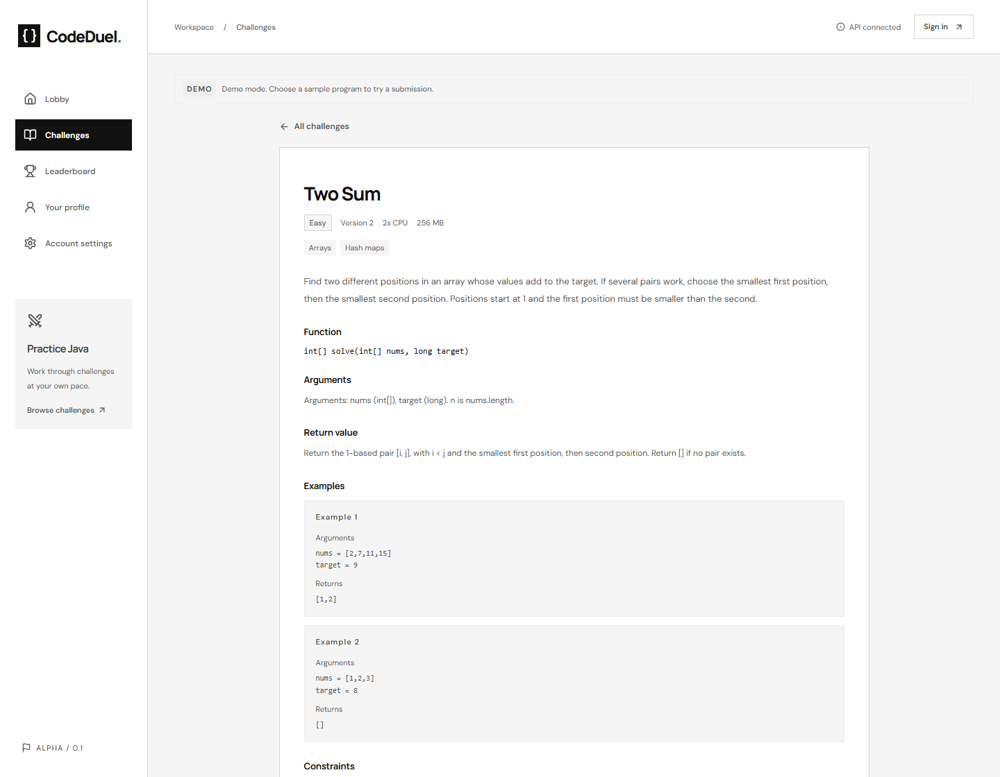

# CodeDuel

CodeDuel is a one-on-one coding game. Both players get the same Java problem and time
limit. The first correct submission wins, based on when the server receives it.

You can play ranked matches, invite a friend to a private room, or practice on your own.
Ranked games affect your Elo rating. Private games and practice do not.

There are 100 problems, from basic arrays and strings to graphs and dynamic programming.
Each one gives you a Java `solve(...)` method with named arguments. Return your answer;
the judge handles calling the method. You can read the signature and examples in the
library before starting a game.



_A problem from the library, with its Java signature and examples._

## Run on Windows

You need **Node.js 24** and **PostgreSQL 17 or newer**. The setup script downloads
Java 21 and Mailpit, installs frontend dependencies, and creates a separate project
database on port 5444.

Open PowerShell in this folder:

```powershell
powershell -ExecutionPolicy Bypass -File .\scripts\windows.ps1 setup
```

Start the backend in one terminal:

```powershell
powershell -ExecutionPolicy Bypass -File .\scripts\windows.ps1 backend
```

Start the frontend in another:

```powershell
powershell -ExecutionPolicy Bypass -File .\scripts\windows.ps1 frontend
```

Open **http://localhost:5173**. Local verification and password reset emails appear in
Mailpit at **http://localhost:8026**.

The demo accounts are `nova` and `atlas`, both with password `CodeDuel-demo-2026!`.
Use separate browser profiles to play both sides of a duel.

The demo judge accepts the supplied sample programs. It does not execute edited Java
code. To run your own solutions, set up the isolated Linux judge using the
[local run guide](docs/local-run-guide.md).

The script keeps tools, database files, and captured email in `.local/`. It leaves the
existing PostgreSQL service on port 5432 alone. Stop the frontend and backend with Ctrl+C,
then stop the local services with:

```powershell
powershell -ExecutionPolicy Bypass -File .\scripts\windows.ps1 stop
```

## Project layout

| Folder             | Contents                                                     |
| ------------------ | ------------------------------------------------------------ |
| `CodeDuelBackend`  | Java 21, Spring Boot, PostgreSQL, and the Maven wrapper      |
| `CodeDuelFrontend` | React, TypeScript, Vite, and the Monaco code editor          |
| `problems`         | 100 challenges, reference solutions, and test generators     |
| `worker`           | Setup for the separate Linux execution environment           |
| `deploy`           | Deployment configuration, monitoring, and database utilities |
| `docs`             | Setup instructions and details about the application         |

Open `CodeDuelBackend` in IntelliJ and `CodeDuelFrontend` in WebStorm. Select the JDK path
printed by setup for IntelliJ's project and Maven runner. The frontend uses Node 24.

## Run with Docker

Docker Desktop is optional. On Windows, the CLI needs a Linux Docker Engine running in
WSL 2 or on a remote machine. See [Windows with Docker CLI](docs/local-run-guide.md#windows-with-docker-cli)
for setup. The native Windows `dockerd.exe` runs Windows containers; this project uses Linux containers.

If you already have Docker and Compose installed, you can start the demo from this folder:

```sh
docker compose up -d --build db mailpit api frontend
```

Use either the Docker stack or the Windows scripts at a time, since they use the same ports.
The [local run guide](docs/local-run-guide.md) also covers macOS and the real judge.

## Checks

To run the GitHub Actions checks locally on this Windows/WSL setup:

```powershell
powershell -ExecutionPolicy Bypass -File .\scripts\check.ps1 -Wsl -Browser
```

Leave off `-Browser` for the backend, problem references, and frontend checks. Add `-Fix`
to apply formatting before checking. See [testing locally](docs/testing.md) for individual
checks, reports, and what to do when a check fails.

From `CodeDuelFrontend`:

```sh
npm run format:check
npm run lint
npm test
```

Backend integration tests need Docker. From the project root, run `mvnw.cmd verify` on
Windows or `./mvnw verify` on macOS/Linux. Browser tests and real judge checks have extra
setup steps in the [local run guide](docs/local-run-guide.md#verify).

For more detail, see the [API reference](docs/api.md), [database notes](docs/database.md),
[rating rules](docs/rating-and-scoring.md), and [deployment guide](docs/deployment-guide.md).
