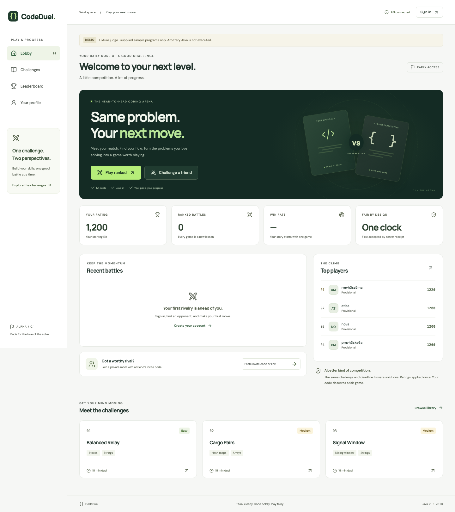

# CodeDuel

**The same problem. The same clock. Your next level.**

CodeDuel is a Java-first competitive coding platform: two players receive the same immutable challenge, submit to an isolated asynchronous judge, then inspect the authoritative outcome, Elo change and replay. The earliest accepted program **by server receipt**, rather than judge completion order, wins.

**Status:** implemented local MVP, with real Java 21 execution, fifteen original challenges, operational deployment files and a separate HTTPS release rehearsal. No public hosting or external security audit is claimed. [Verification evidence](docs/verification.md) distinguishes passing local checks from deployment responsibilities.

## Two IDE projects, one repository

```text
CodeDuel/
├── CodeDuelBackend/     IntelliJ IDEA · Java 21 · Spring Boot · Maven
├── CodeDuelFrontend/    WebStorm · React · TypeScript · Node 24
├── problems/           original source content, references and independent oracles
├── worker/             isolated execution VM and orchestration instructions
├── deploy/             TLS, restricted DB roles, secrets, monitoring and restore drill
├── docs/
└── docker-compose.yml
```

Open each named subfolder in its respective IDE. The backend has its own Maven wrapper and Java 21 configuration; the frontend has its own package setup and WebStorm configuration. Both map to the shared Git root. Shared orchestration runs from this parent folder.

- **[Local run guide](docs/local-run-guide.md)** — IDE setup, fixture demo, real execution VM, host development and tests.
- **[Deployment guide](docs/deployment-guide.md)** — local HTTPS rehearsal, generated administrator, private services, SMTP, backup/restore and hosted configuration.
- [Architecture](docs/architecture.md), [database/locking](docs/database.md), [API](docs/api.md), [scoring](docs/rating-and-scoring.md), [threat model](docs/judge-threat-model.md), [retention](docs/data-retention.md).

## Run locally

For a clearly labelled fixture demonstration:

```sh
docker compose up -d --build db mailpit api frontend
```

Open **http://localhost:5173**. Use `nova` and `atlas` in separate browser profiles, password `CodeDuel-demo-2026!`. The sample selector demonstrates correct/incorrect verdicts without executing edited programs.

For real Java execution on macOS with Lima/Colima:

```sh
worker/sandbox/setup-local.sh
docker compose --profile worker stop api worker
docker compose --env-file .env.judge.local --profile worker up -d --build
```

The dedicated Linux VM has no host filesystem shares or application credentials. The real worker compiles/runs Java 21 using pinned go-judge v1.13.3 with namespaces/cgroups/seccomp and bounded resources. The optional Judge0 adapter remains interchangeable. Full setup and platform-specific routes are in the guides.

## Implemented

- Persistent sessions, CSRF, BCrypt, email verification, one-time password recovery, account anonymization and source retention.
- Rating-window matchmaking, strict active-session claims, one-use private invites, readiness, shared server deadlines, forfeit and consent-based private rematches.
- Immutable source/problem versions, durable fenced job leases, retries/checkpoints, bounded compiler/public feedback and hidden-case privacy.
- Deterministic receipt-order finalization, earlier-pending barrier, infrastructure cancellation without Elo, atomic/idempotent rating history and leaderboard.
- Fifteen original problems with **362 independently generated/oracle-verified cases**; standalone public-example and full practice judging.
- Audited administrator drafting/editing/review/publication/retirement; real accepted reference validation required before publication.
- Locally bundled Monaco/fonts, split-pane arena, draft recovery, authenticated SSE/reconnect, match replay, profiles and rating charts.
- Separate production migration/API/worker DB roles, TLS/secure cookies, private secrets/networks, metrics/alert examples and a non-destructive restore drill.



## Verify

JDK 21, Node 24, Python 3 and Docker are required:

```sh
./mvnw -B -ntp verify
python3 problems/verify_catalog.py
cd CodeDuelFrontend
npm ci
npm run format:check
npm run lint
npm test
npm run build
npm audit --audit-level=moderate
```

`python3 worker/sandbox/verify-local.py` additionally runs the real sandbox and real database-worker checks against the separately provisioned VM. Ordinary Maven verification still requires Docker; it skips only optional real-executor cases when no executor is configured. Frontend browser commands for fixture, real and administrator journeys are in the local guide.

The GitHub Actions workflow is configured; a hosted run requires pushing the repository. Public launch still needs provider-specific firewall/SMTP/certificate/backup/monitoring configuration and sandbox review. Extra languages, tournaments, spectator mode, optimization duels and social features are deferred.
