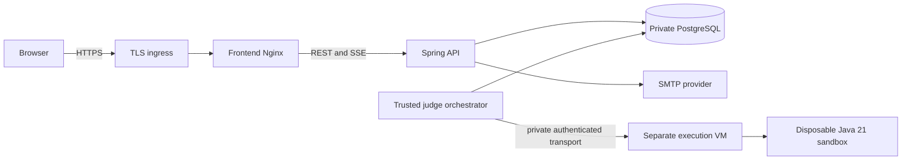

# CodeDuel — deployment guide

This guide covers a verified-local release rehearsal and the files to adapt for a controlled hosted pilot. The two IDE projects share a repository; release orchestration runs from the parent **Desktop/CodeDuel**. No hosting account, domain, cloud resources, or public deployment is created automatically.

## Topology



The execution VM must have no application filesystem mounts, database credentials, Docker daemon, or network path to the production data zone. The orchestrator is a trusted database client and is a separate process from the executor. Start with one API and one worker; JDBC sessions and persisted events survive API restarts.

## 1. Verify and build

Requires JDK 21, Node 24, Python 3, Docker/Compose and the isolated executor from the [local run guide](local-run-guide.md):

```sh
python3 worker/sandbox/verify-local.py
python3 problems/verify_catalog.py
cd CodeDuelFrontend
npm ci
npm run format:check
npm run lint
npm test
npm run build
npm audit --audit-level=moderate
cd ..
```

The GitHub workflow repeats ordinary backend/database and fixture browser checks. A configured workflow is not evidence of a hosted CI run. Real sandbox tests require a dedicated runner and are deliberately optional in ordinary CI.

Application Dockerfiles pin base-image digests and run as non-root users. BuildKit caches Maven downloads without copying the cache into the runtime image. Scan final images and refresh dependency/base/VM pins through reviewed releases.

## 2. Local HTTPS release rehearsal

This is a separate Compose project and database from the ordinary local stack. Stop the ordinary API/worker first on a memory-constrained machine:

```sh
docker compose --profile worker stop api worker
python3 deploy/prepare-local.py
docker compose --env-file .env.deploy.local -f deploy/compose.yml -f deploy/compose.local.yml up -d --build
```

Open **https://localhost:8443** and local email capture at **http://localhost:8027**. Caddy issues a local development certificate; your browser will need its local CA trusted. The verifier uses the extracted CA explicitly, without disabling TLS checks:

```sh
python3 deploy/verify-local.py
```

This creates two synthetic users, confirms delivered verification email, restarts the API without losing a session, plays a ranked Java duel, restarts the worker around queued programs, checks compiler feedback/receipt order/Elo/replay, runs practice, creates a consent-based private rematch, verifies the real admin publishing workflow, and exercises password reset and account deletion. It checks database role boundaries too. Its only fixed targets are localhost and the local rehearsal containers. Signup throttling applies on repeated runs.

`prepare-local.py` creates `.env.deploy.local` and `.secrets/deploy/` without overwriting existing credentials. Parent secret directories are mode 0700; individual read-only secret files can be read by the non-root container only when explicitly mounted. Dotenv contains local configuration, not secret values. Keep both out of Git and backups with broader access.

The initial administrator is **operator**. Its generated password is the private file `.secrets/deploy/bootstrap_password`; read it locally to sign in, without putting it in command-line arguments or logs. Open **Administration** to create a draft, save its tests/reference Java, freeze and verify it, then publish after a real accepted reference result. Published/reviewed content is immutable; clone a new draft to revise it. Known fixture passes cannot satisfy publication.

`migrate` and `grants` are one-shot services and should exit successfully. API and worker use different restricted roles and cannot run schema migrations. The worker cannot read account/session/email tables or update source code. Production API containers do not receive the executor credential.

## 3. Back up and rehearse restoration

After the verifier has created matches and ratings:

```sh
deploy/backup-restore-drill.sh
```

The script briefly stops only the rehearsal API/worker, creates a private logical dump, restores it into a **new disposable database**, compares core row counts and rating arithmetic, and boots the migration process against the restored schema. It drops the disposable database and resumes application processes even on failure. The live database is never overwritten. Dumps remain in ignored `backups/` with restrictive permissions.

For a hosted installation, use encrypted off-host backups/PITR and a maximum 30-day backup retention. Test restoration regularly. Dumps include private source, email tokens/outbox data and credentials. A restore must reapply current deletion requests before serving users; preserve an external restricted deletion ledger or equivalent operator process.

## 4. Adapt the production files

Use `deploy/compose.yml` **without** the local override. It publishes only Caddy on ports 80/443; API, database, worker and metrics stay private. Mailpit exists only in the local override. Choose your real hostname, SMTP provider and execution host.

Create protected configuration and secret files using the local preparation script as a format example. Do not deploy the local generated dotenv unchanged. Required non-secret configuration:

```dotenv
APP_DOMAIN=duel.example.com
PUBLIC_URL=https://duel.example.com
JUDGE_MODE=GO_JUDGE
JUDGE_URL=https://executor.your-private-network.example
BOOTSTRAP_USERNAME=your_initial_admin
BOOTSTRAP_EMAIL=your_verified_admin_address@example.com
SMTP_HOST=smtp.your-provider.example
SMTP_PORT=587
SMTP_USERNAME=your_smtp_login
SMTP_AUTH=true
SMTP_TLS=true
MAIL_FROM=CodeDuel <verified-sender@example.com>
LOCAL_MAIL=false
```

These hostnames are placeholders. `PUBLIC_URL` is the exact canonical HTTPS origin used in verification/reset links, independent of untrusted request headers. Use an authenticated SMTP relay with required STARTTLS and a verified sender. The private `smtp_password` secret file is mounted only into the API. The local-mail exception is limited to localhost plus the Mailpit hostname and cannot authorize a public plaintext-mail configuration.

Secret files expected under `.secrets/deploy/`: `postgres_password`, `migrator_password`, `api_password`, `worker_password`, `metrics_token`, `bootstrap_password`, `smtp_password`, and `judge_token`. Generate distinct high-entropy values; database credentials must be at least 24 characters. Never store them in frontend variables, image layers, Git, CLI arguments or shared IDE configuration. The bootstrap process refuses to elevate an existing regular account and does not reset an existing administrator's password on rerun.

Record immutable application image digests per release. Replace build directives/local image names with registry references or build on your controlled release host. From the parent directory, using the real protected env file:

```sh
docker compose --env-file .env.production -f deploy/compose.yml up -d --build
```

Caddy obtains certificates for the real hostname when DNS and ports 80/443 are correctly configured. Its proxy overwrites the trusted client-address header; prevent direct public access to the API. Same-origin REST/SSE avoids cross-origin session configuration. Access logging is disabled on invite/recovery-sensitive routes; keep error/analytics systems free of tokens and source.

For managed PostgreSQL, use a reviewed Compose override removing the local DB dependency, supply a TLS-verifying JDBC URL and appropriate role provisioning, and execute migrations with the schema-owner identity before applying runtime grants. Do not use the local DB-owner demo configuration as the production runtime policy.

## 5. Execution VM

Provision a **dedicated Linux VM**. Copy `worker/sandbox/mount.yaml` to `/tmp/codeduel-mount.yaml`, then run `install-linux.sh` as root there. The installation refuses host filesystem shares, downloads checksum-pinned go-judge v1.13.3, installs Java 21 and records its exact package/runtime version. Supply `/etc/codeduel-judge.env` with a strong `ES_AUTH_TOKEN` and `ES_SILENT=true`, mode 0600; start `codeduel-judge`.

Expose it only to the trusted worker over an authenticated private VPN/TLS boundary. Enforce host/firewall isolation from application/data/metadata networks and outbound internet. The raw executor listens inside that isolated zone and must never be exposed to browsers. Keep the VM kernel and Java packages patched, record a reproducible VM image and rerun adversarial checks after changes.

Compiler commands, mounts, resource limits and language are exclusively server-owned. Submission bodies cannot override them. The supervisor needs namespace/cgroup privileges inside its dedicated VM; submitted processes run without those privileges. See [the executor instructions](../worker/sandbox/README.md) and [threat model](judge-threat-model.md) for the limits actually exercised.

The alternative Judge0 adapter remains available for operators with a secured Java 21 instance. It needs the correct language ID/name from that instance and its own tested isolation/compile policy; stock Java runtimes must not be assumed to be Java 21. Judge0 is not bundled by this setup. Its GPLv3 obligations differ from the MIT go-judge dependency.

## 6. Operations and rollout

- Health: internal `/actuator/health`; metrics: `/actuator/prometheus` with an ADMIN session or the dedicated metrics bearer token. Example scrape/alert files are in `deploy/monitoring/`. Do not expose management endpoints through the public edge.
- Monitor queue depth, oldest pending age, dead letters and worker-step/failure counters. Alert rules cover stalled queue and infrastructure errors. An external monitoring service must be deployed/configured by the operator.
- Jobs use 60-second leases and fencing tokens. Expired leases recover automatically; administrators can inspect pending/dead jobs and release expired nonterminal leases with an audit record. Completed case checkpoints survive restarts. Terminal verdicts and Elo are immutable; diagnose a dead letter and create a new unranked attempt rather than rewriting history.
- Repeated executor failures cancel an affected match without Elo. A temporary disconnect does not pause the authoritative deadline. A pending earlier submission blocks finalization of a later accepted result.
- Run forward migrations on a restored staging backup before release. Never edit an applied Flyway migration or an existing published seed version. Roll back an image only after confirming schema compatibility.
- Source retention defaults to 90 days; the API maintenance job redacts terminal programs in bounded batches. Account deletion revokes sessions, cancels pending practice jobs, erases source/contact data, and preserves pseudonymous competitive records. See [data retention](data-retention.md).

Before enabling a public audience, verify provider-specific routing/firewalls, encrypted SMTP, certificates, backups, abuse limits and sandbox patch status against that deployment. Local functional/adversarial checks are not a public-host penetration audit. Tournaments, spectators, extra languages and social features are deferred; no public deployment or external audit is claimed.
